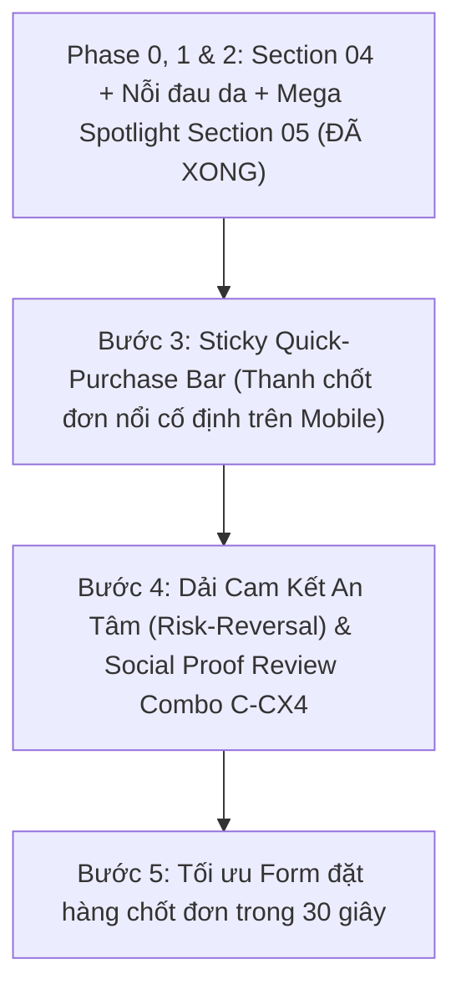

# KẾ HOẠCH NÂNG CẤP GIAO DIỆN & TỐI ƯU CHUYỂN ĐỔI (CRO) TRANG CHỦ
## Bứt Phá Doanh Số Cùng "Combo Siêu Tinh Chất Vi Kim Giảm Thâm Fractional CC | Serum C–CX4"

*Tài liệu kỹ thuật và lộ trình thực thi dành riêng cho dự án website Fractional CC Nhật Bản (`c:\xampp\htdocs\fractionalcc-jp.vn`). Dùng để tiếp tục triển khai các bước tiếp theo trên bất kỳ máy làm việc nào mà không bị gián đoạn bối cảnh.*

---

## 1. BỐI CẢNH DỰ ÁN & MỤC TIÊU CHIẾN LƯỢC

### 1.1. Yêu cầu trọng tâm từ Brief (`brief.docx`)
- **Sản phẩm chiến lược số 1**: *"Combo Siêu tinh chất vi kim giảm thâm Fractional CC | Serum C–CX4"* (Brief dòng 205: *"Anh làm nổi combo này giúp e"*).
- **Mức giá & Ưu đãi chuẩn**:
  - Giá bán combo: **1.237.500đ** (Giá niêm yết gốc: 1.720.000đ - Tiết kiệm ngay 482.500đ).
  - Quà tặng đính kèm: **01 Serum Dưỡng Môi PDRN Shot** trị giá **445.000đ**.
  - Mã định danh kỹ thuật trong hệ thống Form đặt hàng: `combo_127` (mã code: `C-CX4`).
- **Mục tiêu UX/CRO**:
  - Loại bỏ các vùng trống thừa, sắp xếp lại bố cục mạch lạc theo hành trình tâm lý khách hàng (Customer Journey: *Nhận thức công nghệ vi kim -> Thấy nỗi đau làn da của bản thân -> Tìm thấy giải pháp Combo C-CX4 -> Thuyết phục bởi ưu đãi & bằng chứng -> Đặt hàng ngay*).
  - Tối ưu tỷ lệ chuyển đổi mua Combo C-CX4 lên mức tối đa.

### 1.2. Môi trường & Quy chuẩn kỹ thuật
- **Nền tảng**: WordPress Child Theme tại `wp-content/themes/project-child/`.
- **Nguyên tắc bất biến**: Không can thiệp WordPress Core, Parent Theme (`kadence`), hay third-party plugins.
- **Biên dịch CSS/JS**: Theme ưu tiên tải tệp nén gộp `wp-content/themes/project-child/assets/fractional/site.min.css`. Do đó, sau mỗi lần chỉnh sửa `assets/css/style.css`, **bắt buộc chạy lệnh**:
  ```bash
  c:\xampp\php\php.exe scripts/minify-assets.php
  ```
- **Kiểm tra URL cục bộ**: `http://localhost/fractionalcc-jp.vn/` (XAMPP Apache).

---

## 2. TRẠNG THÁI HIỆN TẠI (ĐÃ HOÀN THÀNH)

### ✅ Phase 0: Tối ưu Tầng 3 Section 04 (Trải nghiệm sử dụng & Cảm giác trên da)
- **Vấn đề trước đó**: Giao diện cũ có nhiều khoảng trống thừa, hiệu ứng hover phóng to gây chóng mặt, ảnh minh họa bị crop mất chữ, thừa badge không cần thiết.
- **Kết quả đã xử lý**:
  - Tái cấu trúc thành 4 thẻ nội dung khoa học theo Mục 4.3 trong Brief: *01. Kết cấu đặc trưng, 02. Cảm giác trên da (châm chích êm ái), 03. Cách dùng chuẩn, 04. Lưu ý khi dùng*.
  - Bổ sung "Thanh Lời Khuyên Thao Tác Chuẩn Nhật" (vỗ nhẹ hướng lên, không chà xát).
  - Cập nhật ảnh chính thức `needle-serum-ax4-04.webp` (Attachment ID `73`), thiết lập `object-fit: contain` trên nền màu thương hiệu `#141024`, đảm bảo 100% sơ đồ và chữ trong ảnh hiển thị rõ ràng, không bị che khuất.
  - Loại bỏ hoàn toàn hiệu ứng scale phóng to giật mắt và bỏ badge thừa.

### ✅ Phase 1: Thực hiện Bước 1 - Đưa Section "Nỗi Đau Làn Da" Lên Trang Chủ
- **Vấn đề trước đó**: Mục 11 trong Brief (*"Làn da của bạn đang gặp những vấn đề gì?"*) chỉ xuất hiện ở trang con `/van-de-lan-da/`, trang chủ hoàn toàn thiếu phễu tâm lý này khiến khách hàng không nhận thức được vấn đề da của mình.
- **Kết quả đã xử lý**:
  - Tạo tệp `template-parts/fractional/home/section-concerns.php` và móc nối vào `home.php` ngay giữa Section 04 (Cơ chế) và Section 05 (Danh mục sản phẩm).
  - Trình bày lưới 4 vấn đề da chuẩn Brief:
    1. **Đốm Nâu & Không Đều Màu** (Thẻ nổi bật vàng gold -> Dẫn ngay vào Combo C-CX4).
    2. **Da Thâm Mụn Sau Viêm** (Thẻ nổi bật vàng gold -> Dẫn ngay vào Combo C-CX4).
    3. **Lỗ Chân Lông To & Da Sần** (Dẫn giải pháp Mandelic Shot).
    4. **Da Lão Hóa & Nếp Nhăn** (Dẫn giải pháp Needle Serum AX4 & PDRN).
  - Tích hợp **Thanh chuyển tiếp điều hướng (Transition Bar)** tinh tế ngay dưới 4 thẻ:
    - Lời khuyên chuyên gia da liễu về phác đồ hiệp đồng kép (Serum C + Serum CX4) cho da nám, thâm mụn.
    - Nút bấm *"Xem Combo C–CX4 ưu đãi bên dưới ↓"* dẫn mượt mà vào Section 05 Danh mục, tránh lặp lại banner to và giữ nhịp đọc liền mạch.
  - Tối ưu CSS responsive mượt mà trên cả Mobile, Tablet và Desktop.

### ✅ Phase 2: Thực hiện Bước 2 - Nâng Cấp Mega Spotlight Combo C–CX4 trong Section 05 (Danh mục sản phẩm)
- **Vấn đề trước đó**: Combo C-CX4 chỉ nằm ở góc ô vuông 1 cột bình thường, hoàn toàn chìm nghỉm giữa các sản phẩm đơn lẻ khác.
- **Kết quả đã xử lý**:
  - Mở rộng thẻ Combo C-CX4 thành thẻ **Mega Spotlight Showcase** toàn chiều rộng (`grid-column: 1 / -1;`) với viền ánh kim Gold Gradient sang trọng.
  - Cột 1: Hiển thị bộ ảnh sản phẩm thực tế `combo-c-cx4-gold.webp` + thẻ quà tặng đính kèm `pdrn-shot-lip-essence-01.webp` trị giá 445.000đ.
  - Cột 2: Bảng Giá Trị Cộng Hưởng (Synergy Value Stacking) chứng minh công thức: 01 Serum C (860k) + 01 Serum CX4 (860k) + Quà tặng Dưỡng Môi PDRN (445k) = Tổng trị giá nhận được 2.165.000đ.
  - Cột 3: Hộp chốt đơn giá sốc 1.237.500đ (-28%), nhãn Freeship & kiểm tra hàng, nút mua kết nối tự động với mã `combo_127`.
  - Responsive tối ưu: hiển thị full-width trên mobile, giúp khách hàng lướt trên điện thoại dễ dàng nhìn rõ ưu đãi và bấm mua ngay.

---

## 3. LỘ TRÌNH CÁC BƯỚC TIẾP THEO (GIAI ĐOẠN 3 -> 5)



---

### BƯỚC 2: NÂNG CẤP MEGA SPOTLIGHT COMBO C-CX4 TRONG SECTION 05 (DANH MỤC SẢN PHẨM)
- **Mục tiêu**: Khi khách hàng cuộn xuống danh mục sản phẩm (`#danh-muc`), Combo C-CX4 không bị lẫn với các chai serum đơn lẻ khác mà phải xuất hiện như một "Ngôi sao chủ lực" (Hero Showcase) chiếm trọn sự chú ý.
- **Hạng mục triển khai**:
  1. Thẻ Combo C-CX4 trong lưới sản phẩm được mở rộng thành thẻ đặc biệt (Double-width hoặc Spotlight Banner Card) với viền ánh kim Gold Gradient óng ánh.
  2. Bổ sung nhãn đặc quyền: `⭐ BÁN CHẠY NHẤT • GIẢI PHÁP SỐ 1 CHO DA NÁM THÂM`.
  3. Bổ sung bảng so sánh giá trị cộng hưởng (Synergy Formula):
     - Mua lẻ Serum C (860.000đ) + Serum CX4 (860.000đ) = 1.720.000đ.
     - Mua Combo: Chỉ **1.237.500đ** + TẶNG NGAY Dưỡng môi PDRN **445.000đ** (Tổng trị giá nhận được: 2.165.000đ).
  4. Hiển thị ảnh quà tặng kèm ảnh combo trực quan.

---

### BƯỚC 3: STICKY QUICK-PURCHASE BAR TRÊN MOBILE (THANH CHỐT ĐƠN NỔI CỐ ĐỊNH)
- **Mục tiêu**: Hơn 80% lưu lượng truy cập là điện thoại di động. Khi người dùng cuộn xem qua các phân tích khoa học, một thanh chốt đơn nổi tinh tế sẽ luôn sẵn sàng dưới đáy màn hình giúp khách hàng bấm mua bất cứ lúc nào mà không cần phải cuộn tìm lại nút đặt hàng.
- **Hạng mục triển khai**:
  1. Xây dựng component `sticky-purchase-bar.php` xuất hiện khi cuộn qua 600px màn hình.
  2. Cấu trúc thanh bar:
     - Bên trái: Thumbnail nhỏ Combo C-CX4 + Giá `1.237.500đ` + Tag nhỏ `Tặng son 445k`.
     - Bên phải: Nút bấm màu Gold nổi bật `MUA NGAY (Ưu đãi 28%)` kết nối trực tiếp với modal đặt hàng `combo_127`.
  3. Thiết kế thanh thoát, không che khuất nội dung quan trọng và có nút tắt/ẩn tạm thời nếu khách muốn đọc tiếp.

---

### BƯỚC 4: DẢI CAM KẾT VÀNG (RISK REVERSAL) & ĐÁNH GIÁ THỰC TẾ CHO COMBO C-CX4
- **Mục tiêu**: Xóa tan rào cản do dự (sợ hàng giả, sợ kích ứng, sợ không hợp) để chốt đơn dứt khoát.
- **Hạng mục triển khai**:
  1. Bổ sung dải 4 bảo chứng chuẩn Nhật ngay trước form đặt hàng:
     - 🛡️ **100% Chính Hãng Nhật Bản**: Nhập khẩu chính ngạch, có tem chống giả & công bố Bộ Y Tế.
     - 🌿 **Công Nghệ Vi Kim Tự Nhiên**: Bọt biển thủy phân sinh học độ tinh khiết cao, an toàn cho da nhạy cảm.
     - 🚚 **Miễn Phí Giao Hàng Toàn Quốc**: Kiểm tra hàng trước khi thanh toán.
     - 👩‍⚕️ **Đồng Hành 1:1 Cùng Chuyên Viên**: Theo dõi phác đồ và hỗ trợ chăm sóc da trong suốt liệu trình.
  2. Ghim các đánh giá khách hàng (Reviews) thực tế bám sát kết quả sử dụng Combo C-CX4 (mờ thâm sau 14 ngày, da sáng đều màu, lớp nền ăn phấn).

---

### BƯỚC 5: TỐI ƯU FORM ĐẶT HÀNG CHỐT ĐƠN 30 GIÂY
- **Mục tiêu**: Giảm thiểu tối đa tỷ lệ bỏ rơi giỏ hàng tại bước điền form.
- **Hạng mục triển khai**:
  1. Khi mở modal đặt hàng từ bất kỳ nút nào của Combo C-CX4, ô chọn sản phẩm tự động tick sẵn Combo C-CX4 và hiển thị ngay dòng thông báo nổi: `🎉 Bạn được tặng kèm 01 Serum Môi PDRN 445.000đ`.
  2. Giản lược các trường nhập liệu không cần thiết, tập trung 3 thông tin cốt lõi: Họ tên, Số điện thoại, Địa chỉ nhận hàng.
  3. Bổ sung thông điệp bảo mật thông tin và thời gian giao hàng dự kiến (1-3 ngày).

---

## 4. BỘ CÂU LỆNH MẪU (COPY-PASTE PROMPTS) DÀNH CHO BẠN KHI VỀ NHÀ

*Khi mở máy tính ở nhà, bạn chỉ cần mở Antigravity và sao chép một trong các câu lệnh dưới đây để trợ lý tiếp tục thực hiện ngay lập tức mà không cần giải thích lại:*

### 📋 Câu lệnh 1: Tiếp tục thực hiện BƯỚC 2 (Mega Spotlight Combo C-CX4 trong Section 05)
```text
Dựa vào tài liệu docs/UI-UPGRADE-ROADMAP.md, hãy thực hiện BƯỚC 2 cho tôi:
Nâng cấp Mega Spotlight cho "Combo Siêu Tinh Chất Vi Kim Giảm Thâm Fractional CC | Serum C–CX4" trong Section 05 (Danh mục sản phẩm).
Làm nổi bật thẻ Combo C-CX4 với viền ánh kim Gold, nhãn Bán chạy nhất, bảng cộng hưởng giá trị (mua combo tiết kiệm 482.500đ + Tặng Serum Môi PDRN 445.000đ), kết nối chuẩn nút mua với mã combo_127 và biên dịch lại site.min.css.
```

### 📋 Câu lệnh 2: Tiếp tục thực hiện BƯỚC 3 (Sticky Purchase Bar trên Mobile)
```text
Dựa vào tài liệu docs/UI-UPGRADE-ROADMAP.md, hãy thực hiện BƯỚC 3 cho tôi:
Tạo Sticky Quick-Purchase Bar (Thanh chốt đơn nổi cố định) trên Mobile và Desktop cho Combo C–CX4 (1.237.500đ, tặng kèm dưỡng môi PDRN 445k).
Tự động kích hoạt khi cuộn trang, bấm là mở thẳng popup đặt hàng mã combo_127, đảm bảo giao diện sang trọng chuẩn Nhật và biên dịch lại site.min.css.
```

### 📋 Câu lệnh 3: Tiếp tục thực hiện BƯỚC 4 & BƯỚC 5 (Dải cam kết + Tối ưu Form chốt đơn)
```text
Dựa vào tài liệu docs/UI-UPGRADE-ROADMAP.md, hãy thực hiện BƯỚC 4 và BƯỚC 5 cho tôi:
1. Bổ sung Dải 4 Cam kết An tâm (100% chính hãng Nhật Bản, Miễn phí vận chuyển, Đổi trả nếu kích ứng, Đồng hành 1:1) và các đánh giá nổi bật về Combo C-CX4.
2. Tối ưu Form đặt hàng: tự động tick sẵn Combo C-CX4, hiển thị dòng quà tặng Serum Môi PDRN 445.000đ nổi bật, rút gọn quy trình chốt đơn 30s.
Sau khi xong chạy scripts/minify-assets.php và kiểm tra kỹ lưỡng.
```

### 📋 Câu lệnh 4: Kiểm tra toàn diện và đóng gói bản cập nhật
```text
Hãy chạy kiểm tra toàn bộ trang chủ local tại http://localhost/fractionalcc-jp.vn/, kiểm tra tính toàn vẹn của tất cả các nút CTA mua Combo C-CX4, kiểm tra việc biên dịch site.min.css và báo cáo trạng thái hoàn thiện theo docs/UI-UPGRADE-ROADMAP.md.
```

---

## 5. BẢNG TRA CỨU FILE NGUỒN KỸ THUẬT

| Mục tiêu / Chức năng | Đường dẫn tệp nguồn | Ghi chú |
| :--- | :--- | :--- |
| **Trang chủ chính** | `wp-content/themes/project-child/template-parts/fractional/home.php` | Nơi tập hợp các section |
| **Section Nỗi đau da (Bước 1)** | `wp-content/themes/project-child/template-parts/fractional/home/section-concerns.php` | 4 nỗi đau + Spotlight Combo |
| **Section Cơ chế (Phase 0)** | `wp-content/themes/project-child/template-parts/fractional/home/section-04.php` | 4 trụ cột + Routine + Ảnh 73 |
| **Section Danh mục (Bước 2)** | `wp-content/themes/project-child/template-parts/fractional/home/section-05.php` | Chứa component catalog |
| **Thẻ Combo Component** | `wp-content/themes/project-child/template-parts/fractional/components/combo-card.php` | Card sản phẩm combo |
| **Style CSS chính** | `wp-content/themes/project-child/assets/fractional/assets/css/style.css` | Tệp CSS gốc |
| **Bundle CSS nén** | `wp-content/themes/project-child/assets/fractional/site.min.css` | Tệp WordPress load thực tế |
| **Lệnh nén Bundle** | `scripts/minify-assets.php` | Chạy bằng `c:\xampp\php\php.exe` |
| **Dữ liệu Combo** | `wp-content/plugins/project-core/` | Trả về qua hàm `project_core_fcc_combos()` |
